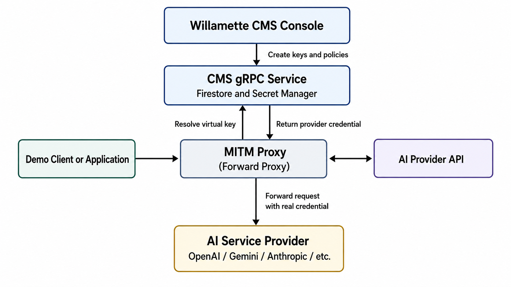

# ZAF Willamette

Zero Trust Access Fabric (ZAF) is a framework designed to enforce last-mile complete mediation and
credential protection for access to API and service providers.

Complete mediation means every access to a resource is checked for authority when it happens.
Most API access falls short of this. Applications typically use bearer credentials such as API keys
and OAuth access tokens. The provider checks the credential on each request, but not who presents
it or whether the owner intended that request. Possession is authority: anyone holding
the credential can use its full scope, whether that's the application, a compromised dependency,
or an attacker who stole it.

AI agents make this worse. An agent decides at runtime which calls to make, chains calls across providers,
sometimes makes wrong decisions, and can be manipulated through prompt injection. Its requests can't be
fully known in advance, so each one has to be authorized when it is made.

ZAF is designed to act as the security gatekeeper for API requests. It sits at the last mile, between
the application or agent and the provider. Each request is verified outside the application against
what the credential owner has authorized, and only a verified request takes effect. The real provider 
redential stays in managed escrow. The application holds only a virtual credential,
so the real one can't be stolen from it. ZAF substitutes the real credential at the point of use,
and only for a verified request. Every request that uses the credential goes through ZAF.
This is how ZAF delivers complete mediation. When an agent makes a wrong decision or is manipulated,
it can use the credential only for what the owner authorized.

ZAF Willamette is a reference implementation of ZAF, provided to ground the architecture in working code. It is explicitly scoped as an illustration of the model, not a canonical or production-complete implementation. It ships with a set of example authenticator signals, used to verify requests and chosen to demonstrate the pattern; implementors can create and register their own authenticators using different signals entirely. For background on the full ZAF model, see Introduction to ZAF ([Introduction to ZAF.md](Introduction%20to%20ZAF.md)).

For a comprehensive view of last-mile authorization, see From Complete Mediation to Last-Mile Authorization ([last-mile-authorization.md](last-mile-authorization.md)).

In this reference implementation, applications use a virtual API key instead of storing a real provider key. The MITM Proxy intercepts the outbound request and sends the virtual key and request metadata to the Credential Management Service (CMS) gRPC service. Only if the request is verified does the CMS return the corresponding real provider credential; the proxy replaces the virtual key with it and forwards the request to the provider. An unverified request never reaches the provider.


## License
ZAF Willamette is released under the terms in [LICENSE.md](LICENSE.md), with
patent use restrictions set out in [PATENT NOTICE.md](PATENT%20NOTICE.md).


## Components

| Component | Purpose |
|---|---|
| [CMS gRPC Service](grpc-service/) | Resolves virtual API keys and returns policy and provider credential data |
| [CMS Console](cms-console/) | Creates and manages virtual API keys and their policies |
| [MITM Proxy](mitm-proxy/) | Intercepts requests and replaces virtual credentials before forwarding |
| [Demo Client](demo-client/) | Tests direct provider calls and Willamette proxy calls |
| [Python SDK Test Client](test-clients/python-sdk/) | Tests direct and proxied requests using provider Python SDKs and documents certificate setup |

## Architecture

The following diagram shows how the Willamette components interact when
creating policies, resolving virtual credentials, and forwarding provider
requests.



```text
                     +----------------------+
                     |  Willamette CMS      |
                     |  Console             |
                     +----------+-----------+
                                |
                                | Create keys and policies
                                v
+----------------+      +-------+--------+      +-------------------+
| Demo Client or | ---> | MITM Proxy    | ---> | AI Provider API   |
| Application    |      +-------+--------+      +-------------------+
+----------------+              |
                                | Resolve virtual key
                                v
                     +----------+-----------+
                     | CMS gRPC Service     |
                     | Firestore and        |
                     | Secret Manager       |
                     +----------------------+
```

## Repository structure

```text
willamette/
├── README.md
├── grpc-service/
├── cms-console/
├── mitm-proxy/
│   └── plugins/
├── demo-client/
│   ├── app.py
│   ├── windows/
│   └── macos/
└── test-clients/
    └── python-sdk/
```

Each component has its own README with setup, configuration, testing,
deployment, and troubleshooting instructions.

## Typical workflow

1. Launch the CMS gRPC Service.
2. Launch the CMS Console.
3. Create a virtual API key and configure its policy.
4. Launch the MITM Proxy and connect it to the CMS gRPC Service.
5. Configure the Demo Client or another application to use the proxy.
6. Send a request using the virtual API key.
7. Verify that the proxy resolves and replaces the credential successfully.

## Current support

Willamette is under active development.

Current behavior depends on the exact CMS and MITM Proxy versions deployed.
Bearer-token replacement is supported by the imported proxy implementation.
Other provider credential formats, such as Gemini query parameters,
`x-goog-api-key`, or Anthropic `x-api-key`, require explicit support in the
proxy implementation.

## Security

- Do not commit provider API keys, passwords, service-account files, or
  private certificates.
- Keep real provider keys in Google Secret Manager.
- Restrict access to the CMS and proxy services.
- Do not expose the MITM Proxy publicly without firewall restrictions,
  authentication, or another access-control layer.
- Do not log authorization headers or provider credentials.

## Google Cloud

The current development deployment uses Google Cloud resources such as:

- Cloud Run for the CMS services
- Firestore for policy metadata
- Secret Manager for provider credentials
- Compute Engine for the MITM Proxy

Refer to the component READMEs for the exact deployment and configuration
steps.
